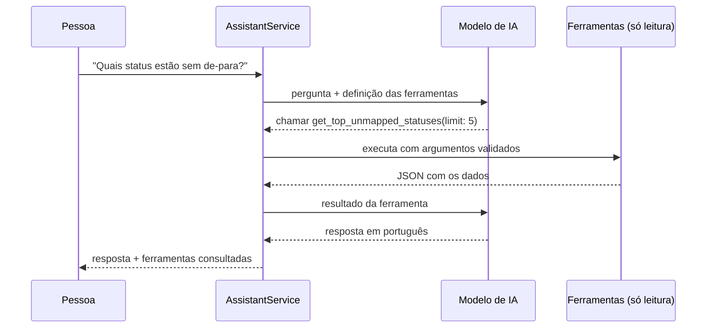

# integration-panel


Painel **full stack** para operar integrações entre um ERP e uma loja virtual: **.NET 10** (ASP.NET Core, EF Core com migrations, JWT) no back-end, **React + TypeScript** no front-end e um **assistente de IA generativa** que responde perguntas sobre a saúde das integrações consultando os dados por **ferramentas (function calling)**.

É o par do [incremental-sync-worker](https://github.com/ErickGabrielS/incremental-sync-worker): o worker sincroniza os pedidos e registra cada resultado; o painel é onde uma pessoa acompanha, reprocessa e aprova os de-para sugeridos pela IA. Os dois usam o mesmo modelo de dados (`IntegrationLogs`, `StatusMappings`, `StatusMappingProposals`). Nesta versão o painel roda com **dados de demonstração** próprios, para ser testado sem nada instalado além do .NET e do Node.

## O que o painel faz

| Tela | O que mostra | Quem pode agir |
| --- | --- | --- |
| **Visão geral** | Totais, taxa de erro, gráfico dos últimos 7 dias e erros por tipo | Todos |
| **Erros** | Itens com erro, com filtro por tipo e paginação | **Aprovador** reprocessa |
| **Propostas de de-para** | Sugestões da IA para status novos do ERP | **Aprovador** aprova (com o sugerido ou outro status) ou recusa com motivo |
| **✦ Assistente IA** | Chat em português sobre a saúde das integrações | Todos (só consulta) |

Toda ação que altera dados gera uma linha de **auditoria** (quem, o quê, quando).

## IA generativa: assistente com ferramentas



O modelo não acessa o banco. Ele **pede** uma ferramenta, a aplicação executa e devolve o resultado, e o modelo escreve a resposta. Ferramentas disponíveis:

- `get_error_summary(days)`: total, erros e erros por tipo no período;
- `get_top_unmapped_statuses(limit)`: status sem de-para, pedidos parados e se já há proposta;
- `get_recent_errors(days, code, limit)`: os erros mais recentes.

**Cuidados de produção:**

- **Só leitura:** nenhuma ferramenta altera dados. Reprocessar e aprovar continuam sendo ações de uma pessoa com perfil de aprovador. Um teste pede uma ferramenta inexistente ("apagar pedidos") e confere que nada muda.
- **Argumentos validados:** os argumentos vêm do modelo, então são convertidos e limitados (ex.: no máximo 30 dias e 10 itens). JSON inválido vira erro, não exceção.
- **Sem inventar números:** o prompt de sistema exige usar só o que as ferramentas devolveram e dizer quando não sabe.
- **Prompt injection:** a pergunta é higienizada e limitada a 500 caracteres, e o modelo é instruído a tratar o conteúdo das ferramentas como dado, nunca como instrução.
- **Controle de custo:** cada chamada ao modelo fica em `AiCalls` com tokens e custo em US$, com **limite diário de chamadas e de gasto**. Estourou, a API responde 429 e o painel continua funcionando.
- **Sem laço infinito:** no máximo `Ai:MaxToolRounds` idas e voltas por pergunta.
- **Provedor trocável** (`Ai:Provider`): `Off`, `Simulator` (padrão, determinístico, usado nos testes e no CI) ou `OpenAiCompatible` (OpenAI, OpenRouter, Ollama ou qualquer API `/v1/chat/completions` com suporte a tools).

## Stack

- **Back-end:** .NET 10, ASP.NET Core minimal APIs, EF Core 10 com **migrations** (SQLite ou SQL Server), autenticação **JWT** com perfis `Viewer` e `Approver`, senhas com `PasswordHasher`, ProblemDetails
- **Front-end:** React 19 + TypeScript + Vite, sem bibliotecas de componentes (CSS próprio)
- **IA:** API compatível com OpenAI com function calling, simulador para testes, `Microsoft.Extensions.Http.Resilience` (retry, timeout, circuit breaker)
- **Qualidade:** xUnit + `WebApplicationFactory` (API de verdade sobre SQLite em memória), GitHub Actions com build da tela e **teste de fumaça da imagem Docker**

## Estrutura

```
src/
  IntegrationPanel.Api/     # API .NET 10
    Auth/                   # login e JWT
    Data/                   # entidades, DbContext, migrations e dados de demonstração
    Endpoints/              # painel, erros, reprocesso, propostas, auditoria e assistente
    Ai/                     # modelos de IA (real e simulador), ferramentas e assistente
  IntegrationPanel.Web/     # React + TypeScript (o build vai para o wwwroot da API)
tests/
  IntegrationPanel.Api.Tests/
```

## Rodando

Precisa do **.NET 10** e do **Node 22+**.

```bash
# 1) compila a tela para dentro da API
cd src/IntegrationPanel.Web && npm install && npm run build && cd ../..

# 2) sobe a API (cria o banco pelas migrations e carrega os dados de demonstração)
dotnet run --project src/IntegrationPanel.Api
```

Abra http://localhost:5180 e entre com um dos usuários de demonstração:

| Usuário | Senha | Perfil |
| --- | --- | --- |
| `aprovador` | `demo-aprovador` | consulta, reprocessa e aprova |
| `leitor` | `demo-leitor` | só consulta |

Para desenvolver a tela com recarga automática, rode a API e, em outro terminal, `npm run dev` em `src/IntegrationPanel.Web` (o Vite encaminha `/api` para a porta 5180).

### Com Docker

```bash
docker build -t integration-panel .
docker run -p 8080:8080 -e Jwt__Key="uma-chave-com-pelo-menos-32-caracteres" \
  -e Demo__Seed=true \
  -e Demo__Users__0__UserName=aprovador -e Demo__Users__0__DisplayName=Aprovador \
  -e Demo__Users__0__Role=Approver -e Demo__Users__0__Password=demo-aprovador \
  integration-panel
```

### Usando um modelo de IA real

```bash
dotnet user-secrets set "Ai:ApiKey" "sua-chave" --project src/IntegrationPanel.Api
dotnet run --project src/IntegrationPanel.Api -- --Ai:Provider=OpenAiCompatible
```

### Testes

```bash
dotnet test
```

Cobrem: login sem revelar se o usuário existe, rotas protegidas, leitor sem permissão para agir, aprovação criando o de-para e devolvendo pedidos para a fila (com auditoria), aprovação com status inexistente recusada, recusa exigindo motivo, reprocesso, paginação e filtro de erros; e no assistente: resposta com dados de ferramenta, resultado da ferramenta devolvido ao modelo, ferramenta inexistente sem efeito, limite de idas e voltas, limite diário (429), registro de custo, argumentos limitados e pergunta higienizada.

## Configuração (`appsettings.json`)

| Chave | Padrão | O que faz |
| --- | --- | --- |
| `Database:Provider` | Sqlite | `Sqlite` ou `SqlServer` |
| `ConnectionStrings:Panel` | `Data Source=panel.db` | Conexão do banco |
| `Jwt:Key` | (vazio) | Chave de assinatura, 32+ caracteres. **Só por variável de ambiente ou user-secrets** |
| `Ai:Provider` | Simulator | `Off`, `Simulator` ou `OpenAiCompatible` |
| `Ai:Model` / `Ai:BaseUrl` | gpt-4o-mini / OpenAI | Modelo e endereço da API |
| `Ai:DailyCallLimit` / `Ai:DailyCostLimitUsd` | 100 / 1.00 | Limites diários do assistente |
| `Ai:MaxToolRounds` | 4 | Idas e voltas por pergunta |
| `Demo:Seed` | false (true em Development) | Carrega usuários e dados de demonstração |

## Próximos passos

- Ler direto a base do incremental-sync-worker (hoje os dados são de demonstração)
- Refresh token e troca de senha
- Testes de interface com Playwright
